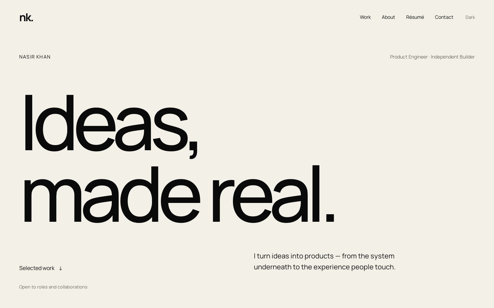
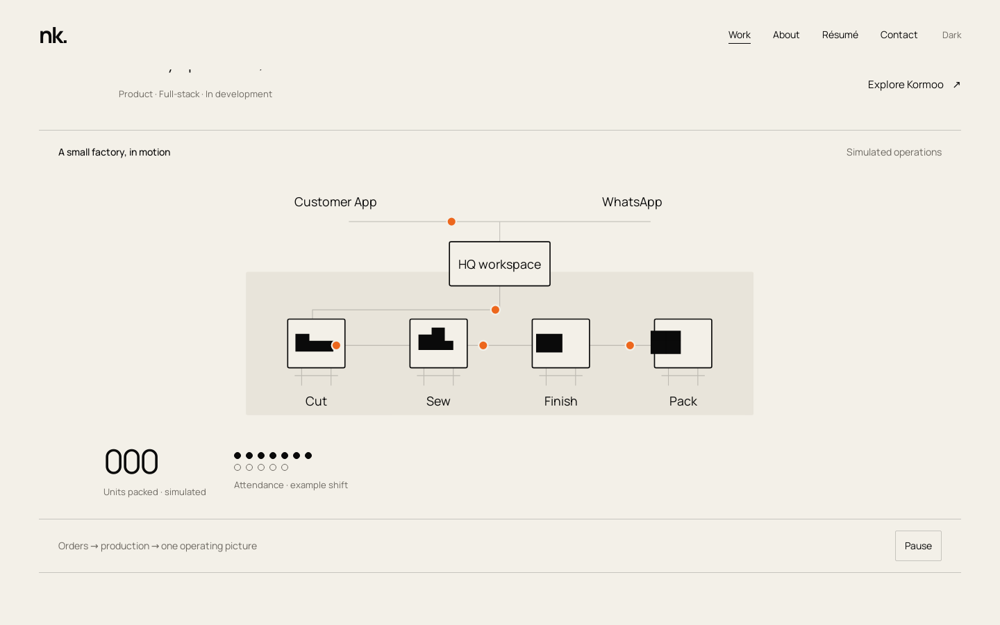
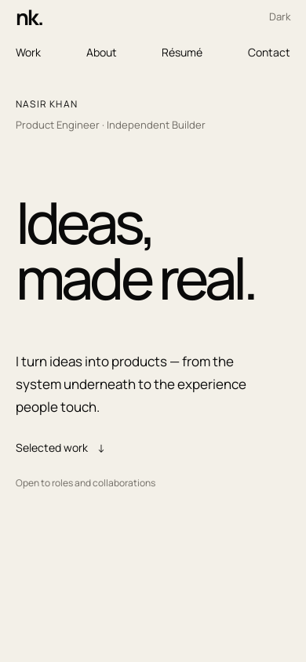

# Nasir Khan - Portfolio

[](https://github.com/Imnasir-X/portfolio/actions/workflows/ci.yml)
[](https://imnasir-x.github.io/portfolio/)
[](./LICENSE)


Portfolio of Nasir Khan, product engineer: full-stack products, AI agent systems and interactive software, each shown with a working in-page preview.

- Live site: https://imnasir-x.github.io/portfolio/
- Vercel mirror: https://nasir-khan-portfolio-cyan.vercel.app/



| Live project preview | Phone layout |
|---|---|
|  |  |

## Features

- Eight project case studies (Kormoo, Sujog.ai, The Age of GenZ, Pathshala, Zephra, an xAI interface study, VoiceArt and Strawberry Shooter), each opening in an accessible dialog addressable by URL (`?project=kormoo`).
- A live, interactive artifact for every project, built with SVG, Canvas 2D, WebGL and Web Audio. No animation libraries and no runtime dependencies.
- Light and dark themes, remembered across visits.
- Animation pauses offscreen and in hidden tabs, and respects `prefers-reduced-motion`. WebGL contexts are released when not visible.
- Responsive from 320 px phones to wide desktops, with no horizontal scrolling.
- Accessible markup: skip link, labelled landmarks and sections, keyboard-operable controls and dialog, alt text on every image.
- Open Graph and Twitter card metadata with a 1200 x 630 preview image.

## Live artifacts

- **Kormoo:** SVG factory flow, simulated orders, packing counter and attendance.
- **Sujog:** scripted agent state machine with human approval, audit history and a kill switch. No model calls or external actions.
- **The Age of GenZ:** scroll-responsive publication stages with explicit stage controls. A sample spread, not a live publication.
- **Pathshala:** role-dependent assignment, teacher-review and class-roster illustrations, with a role switcher and simulated API outcomes. This is separate from the real backend linked in the case study.
- **Zephra:** the original deterministic URL classifier from [zephra-dynamic-landing](https://github.com/Imnasir-X/zephra-dynamic-landing), with editable URL context and an expandable decision trace.
- **xAI study:** an original WebGL data field with selectable relationships. Not affiliated with xAI.
- **VoiceArt:** a WebGL orb driven by local Web Audio analysis, with a generated tone sample and an opt-in microphone. Audio is never recorded or uploaded.
- **Strawberry Shooter:** a Canvas 2D adaptation of the original Python/Pygame game, playable with keyboard or pointer.

## Tech stack

- HTML5, CSS3 and vanilla JavaScript (ES2022); no framework, bundler or build step
- SVG, Canvas 2D, WebGL and Web Audio for the previews
- Self-hosted Manrope and Newsreader fonts (SIL Open Font License, see `assets/OFL-*.txt`)
- Hosting: GitHub Pages (root of `main`) and Vercel (static, no build)
- Tooling: ESLint 9, html-validate, a local-link checker and a Playwright smoke test, run by GitHub Actions on Node 22 and 24

## Quick start

No install is needed to view the site:

```bash
git clone https://github.com/Imnasir-X/portfolio.git
cd portfolio
python3 -m http.server 4268 --bind 127.0.0.1
```

Then open http://127.0.0.1:4268.

To run the same checks as CI:

```bash
npm ci
npm run lint                      # ESLint + html-validate
npm run check:links               # every local reference resolves; no root-absolute paths
npx playwright install chromium   # once
npm run test:smoke                # loads every page and project view under /portfolio/
```

## Project structure

```
portfolio/
├── index.html                    # home page, metadata and project sections
├── portfolio.html                # legacy address, redirects to ./
├── portfolio.js                  # project data, dialog, theme and navigation
├── live-previews.js              # interactive artifacts for each project
├── zephra-core.js                # pure classifier from zephra-dynamic-landing
├── editorial.css                 # base layout and typography
├── illustrations.css             # illustration framing
├── live-previews.css             # artifact styles
├── learning-context-visuals.css  # Pathshala visuals
├── polish.css                    # responsive spacing and shared motion timing
├── og.png                        # Open Graph image (1200 x 630)
├── assets/                       # images, illustrations, fonts and resume PDF
├── illustration-prompts.json     # prompts used for the editorial illustrations
├── docs/                         # README screenshots
├── scripts/
│   ├── check-links.js            # static link and Pages-layout check
│   └── smoke-test.js             # headless Chromium smoke test
├── .github/workflows/ci.yml      # CI
├── .nojekyll                     # serve files as-is on GitHub Pages
├── vercel.json                   # static Vercel config, no build
└── LICENSE
```

## Hosting

GitHub Pages serves the root of the `main` branch at `/portfolio/`, so every asset path is relative. `npm run check:links` fails on any root-absolute path. `.nojekyll` keeps Pages from running Jekyll.

For Vercel, import the repository with Framework Other, the repository root as Root Directory and no build command. `vercel.json` serves the static root directly, and `.vercelignore` keeps tooling and docs out of the deployment. No secrets or environment variables are needed.

## Truth and privacy

Kormoo and Sujog.ai are in development. The Age of GenZ was built and operated. Pathshala and Zephra have public code. The xAI project is an independent interface study with no affiliation. Illustrations are editorial representations, not screenshots or customer photographs. Private project sources, credentials and production records are excluded.

The resume PDF is served unchanged. Image-generation prompts are documented in `illustration-prompts.json`, and responsive exports are in `assets/illustrations/`.

## License

Code is released under the [MIT License](./LICENSE), Copyright (c) 2026 Nasir Khan. The fonts in `assets/` are under the SIL Open Font License (see `assets/OFL-*.txt`). Photographs, illustrations, the resume and project write-ups are personal content and are not covered by the MIT license.
